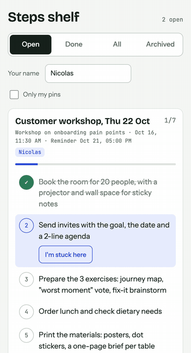
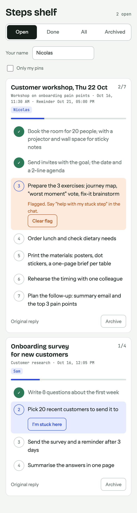
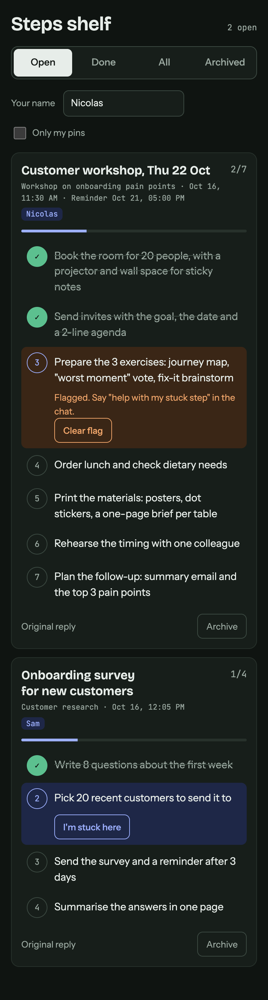
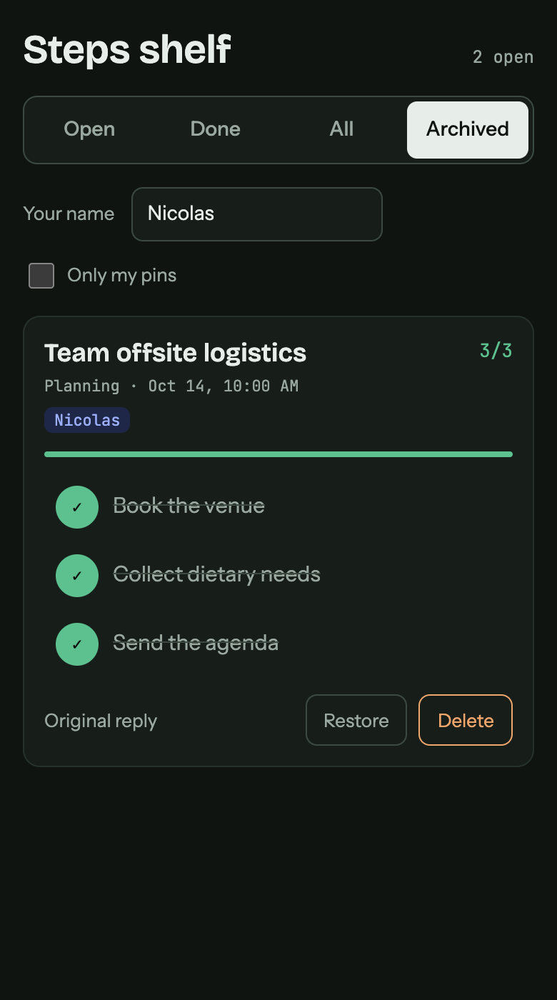

# Steps shelf

Add the steps from a Claude reply to your own Steps shelf (a published Claude artifact with a database). Tick them from any device. Claude reads your progress, helps with a stuck step and sets reminders.

Say "add to the shelf" after a reply with steps, or "what's open?" to read the shelf. Claude opens the shelf in the side panel each time.

## Install (Claude Code)

```bash
claude plugin marketplace add nicopalazzo/steps-shelf
claude plugin install steps-shelf@steps-shelf-marketplace
```

## Setup

The first time you say "add to the shelf", Claude sees you have no shelf yet and asks once: "Create one?" On a yes it publishes `page/shelf.html` as a new artifact on your account and saves its link in `~/.claude/steps-shelf-url` on your machine. After that it never asks again.

- Your shelf is private. Share it from the artifact's Share menu only if you want to.
- The link is never stored in this repo or in the plugin.
- It needs the Artifact tool, which the Claude desktop app has. Without it, Claude keeps your steps in the reply and sets nothing up.
- To start over with a new shelf, delete `~/.claude/steps-shelf-url`.

## Screenshots

Renders of `page/shelf.html` with made-up sample pins, not captures of a real shelf.

Tick a step, then flag the next one as stuck. Ticking a flagged step clears the flag.



| Open pins, light | Open pins, dark | Archived pin |
|---|---|---|
|  |  |  |

## What is in the repo

- `skills/steps-shelf/SKILL.md`: the skill. It reads your shelf link from `~/.claude/steps-shelf-url` and runs first-run setup when the file is missing.
- `page/shelf.html`: the source of the shelf page, to publish as a Claude artifact with the `db` capability.

Pins carry an `owner` name so each person works on their own items. The page has a name field and an "Only my pins" filter. Archived pins can be deleted.

Local test: `claude --plugin-dir <this folder>`

## Changes

- 0.3.1: the command is "add to the shelf" (not "pin the steps"). Existing shelves keep working.
- 0.3.0: each user gets their own shelf, created on first use. No shelf link in the repo.
- 0.2.2: the shelf opens every time it is read, not only after a pin.
- 0.2.0: owner on pins; name field and "Only my pins"; Delete on archived pins (the skill deletes only when asked).
- 0.1.0: first version.
